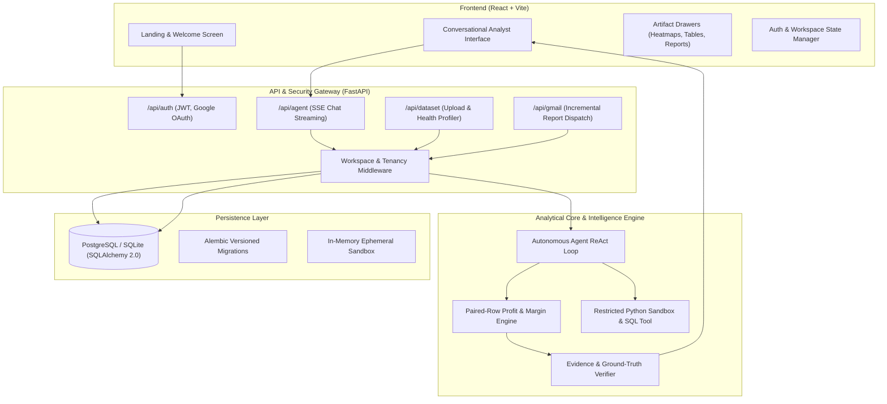

# ANSHora

<div align="center">

<p align="center">
  <strong>Autonomous Business Intelligence &amp; Verified Financial Analytics</strong><br>
  <em>Question the numbers. Discover what matters.</em>
</p>

[](https://github.com/Dev2k30abrd/ANSHora/releases)
[](https://python.org)
[](https://fastapi.tiangolo.com)
[](https://react.dev)
[](https://vitejs.dev)
[](https://github.com/Dev2k30abrd/ANSHora)
[](LICENSE)

</div>

---

## Overview

**ANSHora** is a verified, autonomous business intelligence platform designed for finance teams, executives, and data analysts. Unlike conventional black-box AI tools that produce unchecked estimations, ANSHora pairs large language models with a deterministic mathematical verification engine, formula-level proofs, and strict multi-tenant isolation.

Upload any tabular dataset (CSV, Excel) and ask conversational questions about revenue leakages, profit margins, anomalies, and unit economics. Every answer is mathematically proven, tied to paired line-item evidence, and scored for data integrity.

---

## Key Features

### 🛡️ Evidence-Backed Verification & Mathematical Rigor
- **Paired-Row Margin Analysis:** Automatically enforces weighted gross margins ($\frac{\sum \text{Gross Profit}}{\sum \text{Revenue}}$) across paired valid transactions, preventing biased row-average margin fallacies.
- **Data Quality Scoring (0–100):** Transparent health evaluation measuring completeness, uniqueness, and type contamination without penalizing valid business outliers.
- **Multi-Currency Protection:** Detects currency symbols and ISO codes (`USD`, `$`, `INR`, `₹`, `EUR`), normalizes equivalent notations, and halts computations when conflicting currency pools are mixed.
- **Verification Popovers:** Every metric displays an interactive proof badge revealing the SQL/Python formula, execution runtime, confidence interval, and data slice used.

### 🏢 Multi-Tenant Architecture & Workspace Isolation
- **Dual-Engine Persistence:** Built on SQLAlchemy 2.0 with instant zero-configuration SQLite for local development and enterprise-ready PostgreSQL for production.
- **Alembic Database Migrations:** Version-controlled database schema management with automated SQLite-to-PostgreSQL migration scripts (`scripts/migrate_sqlite_to_pg.py`).
- **Strict Row-Level Tenancy:** Datasets, conversations, decisions, reports, and monitors are cryptographically isolated by `workspace_id` to prevent cross-tenant IDOR access.

### 🔑 Google Sign-In & Incremental Gmail Authorization
- **Single-Click Authentication:** Google Identity Services (`openid`, `email`, `profile`) for instant authentication and automatic account linking.
- **Granular Report Delivery:** Optional, incremental consent for Gmail delivery (`https://www.googleapis.com/auth/gmail.send`). Users can authorize automated board-briefing email dispatches directly from the chat agent, or decline permissions while retaining full analytics capabilities.

### 👤 Ephemeral Guest Sandbox vs. Authenticated Continuity
- **Ephemeral Guest Mode:** Unauthenticated users can instantly explore sample datasets and ask questions in an ephemeral sandbox. No conversations or data are persisted across sessions or browser restarts.
- **Persistent Account History:** Authenticated accounts retain continuous multi-session chat histories, saved datasets, custom workspaces, and organizational memory.

### 🎨 Claude-Inspired Editorial Interface
- **Distraction-Free Aesthetics:** High-contrast editorial typography, warm natural stone theme (`#1C1A17`, `#FAF8F5`, `#A8A29E`, `#E28766`), and zero visual clutter.
- **Live Execution Timelines:** Real-time visibility into the agent's analytical thinking, Python sandbox executions, and SQL queries.
- **Artifact Side Panels:** Dedicated interactive drawers for executive briefings, profit sensitivity heatmaps, and raw query tables.

### 📦 Agensi Marketplace Skill Package
- Contains `anshora-business-intelligence-analyst`, a self-contained, offline-first Agensi marketplace skill package adhering to standard-library Python execution, zero external dependencies, and complete archive validation (`v1.0.0` through `v1.0.3`).

---

## Architecture



---

## Project Structure

```
ANSHora/
├── backend4/                       # FastAPI Backend Application
│   ├── alembic/                    # Alembic migration scripts and revisions
│   ├── app/
│   │   ├── agents/                 # Multi-step ReAct agent & tools registry
│   │   ├── core/                   # Security, tenancy context, database session, config
│   │   ├── models/                 # SQLAlchemy ORM models (User, Workspace, Dataset, Chat)
│   │   ├── routes/                 # REST & SSE streaming endpoints
│   │   ├── services/               # Profit engine, data health, Gmail service, Google Auth
│   │   └── tools/                  # Python code runner, SQL runner
│   ├── tests/                      # 78 backend pytest test cases
│   ├── requirements.txt            # Python dependencies
│   └── .env.example                # Sanitized backend environment template
│
├── frontend5/                      # React 18 + Vite 6 Frontend Application
│   ├── src/
│   │   ├── components/             # LandingScreen, ChatInterface, Header, Sidebar, Panels
│   │   ├── services/               # API client, SSE streaming, authentication
│   │   └── __tests__/              # Vitest test suite
│   ├── package.json                # Frontend dependencies
│   └── .env.example                # Sanitized frontend environment template
│
├── marketplace/                    # Standalone Agensi Marketplace Skill
│   └── agensi/
│       ├── anshora-business-intelligence-analyst/
│       │   ├── SKILL.md            # Agensi Skill declaration
│       │   ├── scripts/            # Standalone CSV analysis engine (analyze_csv.py)
│       │   └── references/         # Analytical methodology, financial formulas
│       ├── releases/               # Packaged ZIP releases (v1.0.0 - v1.0.3)
│       └── tests/                  # 48 packaging checks & 36 standalone CSV tests
│
├── .gitignore                      # Hardened root gitignore
├── FINAL_QA_REPORT.md              # Detailed QA validation audit
└── README.md                       # Main documentation
```

---

## Quickstart Guide

### Prerequisites
- **Python:** `3.11` or higher
- **Node.js:** `18.x` or higher (`npm` or `pnpm`)
- **Git**

---

### 1. Clone the Repository
```bash
git clone https://github.com/Dev2k30abrd/ANSHora.git
cd ANSHora
```

---

### 2. Backend Setup (`backend4`)

```bash
# Navigate to backend directory
cd backend4

# Create and activate virtual environment
python -m venv venv

# On Windows (PowerShell):
.\venv\Scripts\Activate.ps1
# On Linux / macOS:
source venv/bin/activate

# Install dependencies
pip install -r requirements.txt

# Configure environment
cp .env.example .env

# Run Alembic migrations (creates local database schema)
alembic upgrade head

# Start development server
uvicorn app.main:app --reload --host 127.0.0.1 --port 8000
```

> **Interactive API Docs:** Visit [http://127.0.0.1:8000/docs](http://127.0.0.1:8000/docs)  
> **Health Check:** [http://127.0.0.1:8000/health](http://127.0.0.1:8000/health)

---

### 3. Frontend Setup (`frontend5`)

Open a new terminal window:

```bash
# Navigate to frontend directory
cd frontend5

# Install dependencies
npm install

# Configure environment
cp .env.example .env

# Launch Vite development server
npm run dev
```

> **Application UI:** Open [http://localhost:5173](http://localhost:5173) in your browser.

---

## Environment Configuration

### Backend (`backend4/.env`)
| Variable | Description | Default |
| :--- | :--- | :--- |
| `DATABASE_URL` | PostgreSQL connection string (falls back to SQLite if unset) | `sqlite:///data/anshora.db` |
| `LLM_API_KEY` | API key for OpenAI / OpenRouter / Anthropic compatible LLM | *(Empty for Demo Mode)* |
| `LLM_BASE_URL` | Base endpoint for LLM API | `https://openrouter.ai/api/v1` |
| `LLM_MODEL` | Default LLM model identifier | `openai/gpt-4o-mini` |
| `JWT_SECRET` | Secret key for signing user authentication tokens | *(Auto-generated if empty)* |
| `AUTH_REQUIRED` | Enforce authentication gating (`true` or `false`) | `true` |
| `GOOGLE_SIGNIN_CLIENT_ID` | Google OAuth Client ID for User Sign-In | *(Optional)* |
| `GOOGLE_SIGNIN_CLIENT_SECRET`| Google OAuth Client Secret for User Sign-In | *(Optional)* |
| `GOOGLE_CLIENT_ID` | Google OAuth Client ID for Gmail Report Delivery | *(Optional)* |
| `GOOGLE_CLIENT_SECRET` | Google OAuth Client Secret for Gmail Report Delivery | *(Optional)* |
| `CORS_ORIGINS` | Permitted frontend origins | `http://localhost:5173,http://127.0.0.1:5173` |

### Frontend (`frontend5/.env`)
| Variable | Description | Default |
| :--- | :--- | :--- |
| `VITE_API_URL` | Backend API base URL | `http://127.0.0.1:8000` |
| `VITE_GOOGLE_CLIENT_ID` | Optional Google Web Client ID for One-Tap / Popup sign-in | *(Optional)* |

---

## Verification & Test Suites

The platform includes exhaustive testing across backend APIs, frontend interfaces, security layers, and marketplace packages.

```bash
# 1. Run all 78 Backend Pytest Tests
pytest backend4/tests -v

# 2. Run Frontend Tests (Vitest)
npm test --prefix frontend5 -- --run

# 3. Run Frontend Linter (ESLint)
npm run lint --prefix frontend5

# 4. Verify Frontend Production Build
npm run build --prefix frontend5

# 5. Run Agensi Marketplace Package Integrity Validator (48 checks)
python marketplace/agensi/tests/validate_package.py

# 6. Run Agensi Standalone CSV Analytical Tests (36 tests)
python marketplace/agensi/tests/test_analyze_csv.py
```

### Test Metrics Summary
- **Backend Tests:** 78 / 78 Passed (Multi-tenancy, Google Auth, Gmail, Accuracy Benchmarks)
- **Frontend Tests:** 10 / 10 Passed (Component rendering, AuthScreen, ChatInterface)
- **Frontend ESLint:** 0 Errors, 0 Warnings
- **Agensi Package Checks:** 48 / 48 Passed (33 source checks + 15 archive checks)
- **Agensi Analytical Tests:** 36 / 36 Passed (100% mathematical ground-truth conformity)

---

## Agensi Marketplace Skill Package

The standalone skill located in `marketplace/agensi/anshora-business-intelligence-analyst/` is engineered for drop-in use in any AI agent runtime:

```bash
# Direct CLI execution (zero third-party dependencies):
python marketplace/agensi/anshora-business-intelligence-analyst/scripts/analyze_csv.py path/to/dataset.csv
```

### Verified Release Archives
Verified release ZIPs with cryptographic SHA-256 checksums are located in `marketplace/agensi/releases/`:
- `v1.0.0`: Initial Agensi release package.
- `v1.0.1`: Data health penalties & IQR outlier thresholds.
- `v1.0.2`: Strict calculation method isolation (no mixed profit derivation).
- `v1.0.3`: Enhanced multi-currency normalization & cost-source disclosure.  
  `SHA-256: 564d66aa028c059be69eaa652342322b39c0ba0dabdb60035c24e8a7b64dbf32`

---

## Security & Privacy Commitment

1. **Zero Data Leakage:** Tabular datasets and user queries are kept within your designated workspace. Uploaded datasets are never used to train public models.
2. **Deterministic Fallbacks:** When offline or when LLM API keys are unset, ANSHora's deterministic rules engine and statistical profiling continue to function.
3. **No Hidden Tracking:** Telemetry, cookies, and tokens are restricted to the local session.
4. **Credential Isolation:** Google Identity authentication tokens are strictly separated from Gmail delivery tokens.

---

## License

This project is licensed under the MIT License. See the [LICENSE](LICENSE) file for details.

---

<div align="center">
  <sub>Engineered with precision for verifiable financial analytics.</sub>
</div>
