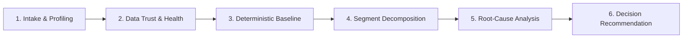

# Analytical Methodology Reference

This guide outlines the core analytical framework used by the **ANSHora — Business Intelligence Analyst** skill. It governs how an AI agent structures investigation, decomposes metrics, evaluates hypotheses, and separates observed facts from recommendations.

---

## 1. The Six-Stage Investigation Lifecycle

Every business analysis must progress through six rigorous steps:

1. **Intake & Profiling**: Parse raw headers, detect data types, map column semantics, and build an explicit capability boundary.
2. **Data Trust & Health**: Audit row counts, missing values, exact duplicate rows, type anomalies, and outliers. Disclose all imperfections upfront.
3. **Deterministic Baseline**: Compute headline financial metrics (Revenue, Cost, Gross Profit, Weighted Margin, AOV) using exact arithmetic.
4. **Segment Decomposition**: Group performance by key business dimensions (Product Category, Customer Segment, Geography/Channel) to locate concentration risks and margin variances.
5. **Root-Cause Analysis**: Distinguish *what* changed from *why* it changed using driver decomposition.
6. **Decision Recommendation**: Translate quantitative findings into prioritized, owner-assigned business actions with measurable target metrics.

---

## 2. Driver Decomposition (Root-Cause Analysis)

When a metric changes significantly (e.g. revenue drops 25% or gross margin shrinks by 400 bps), perform decomposition across two primary axes:

### A. Volume vs. Price vs. Cost Mix
- **Price Effect**: Did average realized unit prices drop (e.g. through excessive discounting or promotional markdowns)?
- **Volume Effect**: Did unit sales volume decline while unit prices remained steady?
- **Cost / COGS Effect**: Did unit procurement or fulfillment costs rise faster than top-line pricing?
- **Mix Shift**: Did consumer preference shift from high-margin SKUs to low-margin SKUs? (A shift in mix is a commercial preference observation, not operational waste).

### B. Segment Contribution Analysis
Decompose overall changes across categorical dimensions:
$$\Delta \text{Metric}_{\text{total}} = \sum_{i=1}^{n} \Delta \text{Metric}_{\text{segment}_i}$$

Each segment's percentage contribution to the change is:
$$\text{Contribution } \% = \frac{\Delta \text{Metric}_{\text{segment}}}{\Delta \text{Metric}_{\text{total}}} \times 100$$

---

## 3. Epistemic Separation: Facts vs. Hypotheses vs. Actions

To prevent AI hallucination and overconfidence, every analytical deliverable must maintain strict epistemic hygiene:

| Classification | Definition | Required Standard of Proof | Example |
|---|---|---|---|
| **Observed Fact** | Direct data point present in the file | Exact row or column value cited directly | "Category Furniture generated $95,800.00 across 8 orders." |
| **Calculated Result** | Deterministic arithmetic derivation | Verifiable formula; weighted calculation | "Overall company gross margin is 31.41% ($86,700 ÷ $276,000)." |
| **Hypothesis** | Plausible causal explanation for a pattern | Explicitly labeled as hypothesis; lists disconfirming data | "Furniture margin underperformance *may* be driven by discretionary rep discounting." |
| **Recommendation** | Proposed operational business decision | Tied to quantified expected impact, designated owner, and review date | "Cap Furniture discretionary discounting at 8% to capture $3,590.00 in margin leakage." |

---

## 4. Avoiding False Causal Claims

1. **Correlation vs. Causation**: Never claim that variable A caused variable B simply because they trend together. Frame non-experimental findings as *associations* or *co-occurrences*.
2. **Missing Confounders**: Acknowledge unobserved variables (e.g. competitor actions, seasonal weather, ad spend changes, inventory stockouts) when the dataset lacks external context.
3. **No Retrospective Fabrication**: Never invent explanations that cannot be tested against data in the file. If reasons for return are not recorded, state: *"Return reasons are unrecorded in this dataset."*
